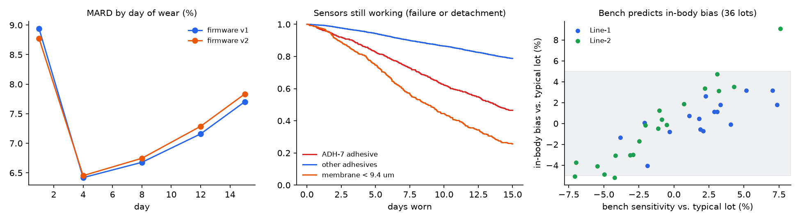

# CGM Sensor Performance & Reliability Lab — Accuracy, Failures, Lot Release and Signal Artifacts

A product-development analytics study of a continuous glucose monitor (CGM), using the four kinds of data such a
team works with:

| Data | In this lab |
|---|---|
| **Bench** | 960 sensors from 48 manufacturing lots tested in buffer (in-vitro sensitivity) |
| **Manufacturing** | each lot's line, membrane thickness, enzyme loading and adhesive batch |
| **Clinical** | 720 participants on 36 lots, 15-day wear, lab reference glucose every 15 min on 5 clinic days (172,800 paired readings) |
| **Real world** | 6,000 sensor sessions: how long each lasted and why it ended; 4,000 overnight 3-hour CGM traces |

The questions are the ones design teams ask:
- **How accurate is the sensor, and where is it weakest?**
- **Is the new firmware filter better?**
- **Can a bench test predict a lot's in-body bias before release?**
- **Why do sensors end early, and what manufacturing tolerance would fix it?**
- **Can the CGM tell a false overnight low (sensor compressed during sleep) from a real one?**

> **Simulated program, known truth.** Glucose curves (meals, daily rhythm, hypoglycaemia), the sensor (≈10-minute
> interstitial lag, lot gain, first-day bias, drift over the wear, noise) and failures (Weibull hazards with planted
> causes) are simulated. Every lot's true in-body bias and every failure's cause are known, so each analysis can
> be checked. It is not Dexcom data, and the effect sizes are illustrative.

> **Status.** Everything ran here: simulation, all analyses, the dashboard and 9 tests. Python only; no MATLAB.



## 1. Accuracy against the lab reference (firmware v1)

| Metric | Result (95% CI, resampling participants) |
|---|---|
| MARD | **7.4%** (7.2–7.5%) |
| Within 20/20 (±20 mg/dL below 100, ±20% above) | 96.6% (96.4–96.9%) |
| Clarke error grid | A 96.5%, B 3.4%, D 0.11%, C and E 0% |

- **Day 1 is the weakest day:** MARD 8.9% on day 1, 6.4% on day 4, rising to 7.7% by day 15 as sensitivity
  drifts.
- **Lows are the hardest range:** below 70 mg/dL, MARD is 17% (mean absolute difference 9.1 mg/dL), vs. 7.5% in
  70–180 mg/dL. Relative error inflates at low glucose, which is why low-range accuracy is reported in mg/dL.
- **No difference by diabetes type:** T1D 7.5% (7.2–7.7%), T2D 7.3% (7.0–7.4%).

## 2. Firmware v2 vs. v1, paired on the same sensors

Both filters were run on the same raw sensor signals, so every comparison is paired and the confidence intervals
resample participants.

| | v1 | v2 | v2 − v1 (95% CI) |
|---|---|---|---|
| MARD, all pairs | 7.38% | 7.42% | +0.04 points (+0.02 to +0.06) |
| MARD when glucose moves > 1 mg/dL/min (15,420 pairs) | 15.0% | **12.8%** | **−2.2 points** (−2.3 to −2.1) |
| MARD when glucose is stable | 6.63% | 6.89% | +0.26 points |
| Mean error below 70 mg/dL | 9.1 mg/dL | **7.1 mg/dL** | **−2.0 mg/dL** (−2.4 to −1.7) |
| Delay behind true glucose | 15 min | **10 min** | |
| Noise (second difference) | 9.2 | 12.9 | +40% |

**Headline MARD says "no change", but that hides a trade-off.** v2 compensates for lag, so it is much better in
the moments that matter clinically (falling into a low, rising after a meal) and slightly worse when glucose is
flat, where its extra noise shows. Whether to ship it is a product decision; the data say it helps low alerts
and makes the trace look jumpier.

## 3. From the bench to the body: lot release

Can the in-vitro bench test predict a lot's in-body bias (its deviation from the typical lot) before any clinical
data exist?

- **Yes, mostly:** across the 36 clinical lots, bench sensitivity explains 73% of the variation in in-body bias
  (slope 0.78, CI 0.64–0.92).
- **The bench reads differently by line:** adding the production line finds that Line-2 lots read 1.8 points lower
  on the bench than in the body (CI 0.7–2.9). R² rises to 0.80; leave-one-lot-out error is 1.5 points.
- **As a release rule it changed little:** holding a lot when the model gives a > 20% chance of being outside ±5%
  catches **5 of the 7** truly out-of-spec lots (all 48 lots scored, clinical lots leave-one-out). It also holds 6
  good lots. Using the bench number alone also catches 5 and holds 4 good lots. Both rules' misses are thick-membrane
  lots just past the limit (true bias −5.0% to −5.9%), and some wrongly held lots sit just inside it (e.g. −4.6%).
  **Lesson: the line correction is real, but at a ±5% limit lots near the boundary are close calls for any
  bench-based rule. Membrane thickness predicts the direction of the bias (thick reads low, thin reads high), so it
  is a natural second release check.**

## 4. Reliability: why sensors end early

68% of real-world sessions reach the full 15 days; 16% end in detachment, 10% in sensor failure, 6% removed for
other reasons.

**Ranking lots by "ended early" mixes two different problems:** the worst three lots are thin-membrane lots, the
next three all use adhesive batch ADH-7. A **cause-specific Cox model** (failure and detachment as separate
outcomes, other endings censored; standard errors clustered by lot) separates them:

| Factor | Sensor failure: hazard ratio (95% CI) | Detachment: hazard ratio (95% CI) |
|---|---|---|
| Membrane: each 0.1 µm thinner than 9.4 µm | **1.42** (1.41–1.44) | 1.02 (0.99–1.06) |
| Adhesive batch ADH-7 | 0.84 (0.65–1.08) | **6.47** (5.69–7.36) |
| Arm (vs. abdomen) | 1.21 (1.05–1.39) | **0.72** (0.63–0.82) |
| Active user (sport, swimming) | 0.89 (0.72–1.11) | **2.10** (1.91–2.31) |
| Line-2, firmware v2 | no effect | no effect |

- **Membrane thickness causes failures; the adhesive causes detachments.** Failure rates by thickness band are
  flat above 9.4 µm (6–7% by day 15) and climb steeply below it (82% below 9.0 µm), which is why thickness enters
  the model as "µm below 9.4".
- **One false lead, flagged:** arm placement shows a 21% higher failure hazard (p = 0.009), but the simulation has
  no such effect. With 12 tests, one chance finding is expected. It should be confirmed in new data before anyone
  acts on it.
- **A tolerance, chosen on 2024 lots and checked on 2025 lots:** rejecting lots thinner than **9.0 µm** cut early
  failures (before day 10) from 7.4% to 3.4% of sessions in 2024, scrapping 8% of output. On 2025 lots the same
  rule took early failures from 5.7% to 3.2%, scrapping 4%.
- **The adhesive needs its own fix:** with ADH-7, only 47% of sensors last 15 days without failing or detaching,
  vs. 79% with other batches.

## 5. Overnight false lows: compression vs. real hypoglycaemia

When someone sleeps on the sensor, pressure makes the CGM read low and can sound a false low alarm. 1,604 of the
4,000 overnight windows would trigger an alarm (CGM < 70 mg/dL), and 42% of those alarms are compressions.

A LightGBM model on the shape of the dip (fall rate, depth, rebound speed, time below 70, roughness) is tested on
held-out sensor sessions. The rule it suppresses alarms by was chosen safety-first, so that at most 1% of real lows
in training would be silenced.

| On held-out sessions (295 real lows, 228 compressions) | Compression alarms removed | Real lows silenced |
|---|---|---|
| Rule: "bounced back faster than 2 mg/dL/min" | 27% | **56 of 295** |
| **Model** (AUC 0.97) | **63%** | **1 of 295** |

The share of false alarms falls from 42% to 21%. The rule looks reasonable but would silence one real low in five:
the reason this needs a model, a safety-first threshold, and clinical sign-off before it changes any alarm.

## Dashboard

[`docs/dashboard.html`](docs/dashboard.html) is an interactive page for design teams (Plotly). It shows:
- headline tiles;
- MARD by day and error by glucose range, v1 vs. v2;
- a Clarke error grid;
- Kaplan-Meier curves by adhesive and membrane;
- the lot-release view with each lot's predicted bias and hold decision.

Open it in a browser; it is self-contained (Plotly is embedded) and works offline.

## Run it

```powershell
python -m venv .venv; .venv\Scripts\activate
pip install -r requirements.txt
pytest -q                                  # 9 tests (~10 s)
python -m cgm.study                        # results/results.json (~25 s)
python -m cgm.dashboard                    # docs/dashboard.html + results/overview.png
```

## Layout
```
cgm/
  sim.py         lots, bench tests, glucose physiology, sensor model, firmware filters, clinical study,
                 real-world sessions with failure causes, overnight windows
  analysis.py    accuracy (MARD, 20/20, Clarke grid, cluster bootstrap), paired firmware comparison,
                 bench-to-body model and release rule, Kaplan-Meier + cause-specific Cox, tolerance,
                 compression-low model with a safety-first threshold
  study.py, dashboard.py
tests/           9 tests (error-grid zones, 20/20 rule, bootstrap, planted causes recovered, safety of suppression)
docs/dashboard.html
```

## Limits
- **Simulated physiology and sensors.** Real CGM data has calibration events, sensor warm-up, connectivity gaps,
  and reference methods with their own error structure.
- **The Clarke grid is shown for familiarity;** regulatory submissions use other accuracy standards. MARD here is
  computed against simulated lab references on clinic days only.
- **Release decisions use one ±5% limit and 48 lots.** With so few out-of-spec lots, catch rates are uncertain.
- **No MATLAB;** everything is Python (pandas, statsmodels, lifelines, LightGBM, Plotly).
